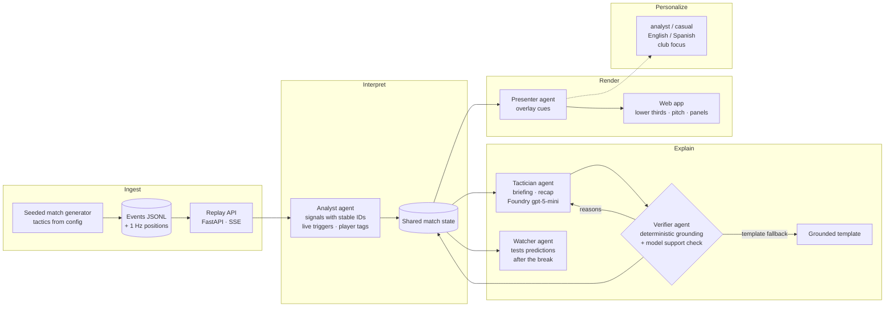

# Second Act

**A half-time tactical read that checks itself.**

**Live demo:** https://second-act.bluecliff-fc92b3c6.swedencentral.azurecontainerapps.io · **Video:** _(link)_ · Built for the Microsoft × Premier League *Inside the Game* hackathon, challenge "The Synthetic Match Insights Engine for Premier League Studio".

Second Act is a multi-agent system that turns a live stream of synthetic football events into explainable match intelligence for studio and streaming.

- **First half:** it tracks tactical signals and surfaces live cues.
- **Half-time:** it explains what's working for each team and predicts what each manager will change, with every prediction written as a measurable test. A verifier checks every claim against the data before anything reaches the screen.
- **Second half:** it confirms or contradicts each prediction on screen as play unfolds.
- **Full time:** it produces a verified recap of how the tactical battle played out.

Everything is delivered as timed overlay cues, in analyst and casual versions, in English and Spanish, and from either club's point of view.

**Why it matters.** Studio analysis makes confident half-time calls and never comes back to them, and language models writing commentary invent numbers. Second Act makes the read accountable: every number traces to a computed signal, every prediction is a test, and the system shows on air when it was wrong.

## How it works



| Pipeline stage | Component | Where |
| --- | --- | --- |
| **Ingest** | Seeded generator (tactics drive events and positions); replay at configurable speed over server-sent events | `sim/`, `api/` |
| **Interpret** | Analyst: about 1,300 signals per match (PPDA, field tilt, channel entries, turnover height, xG, pass difficulty, control index, defensive line, sprints…) per five-minute window and per half, plus live triggers and player tags | `analytics/`, `agents/analyst.py` |
| **Explain** | Tactician writes the half-time briefing and full-time recap. Verifier: deterministic grounding plus a model support check, with prune, retry or template fallback. Watcher: deterministic verdicts and a grounded one-line explanation | `agents/`, `orchestration/` |
| **Render** | Presenter turns everything into overlay cues following a documented JSON contract; the web app shows lower thirds, the pitch and the panels | `agents/presenter.py`, `web/`, [docs/cue_contract.md](docs/cue_contract.md) |
| **Personalize** | Each cue in 12 variants (audience × language × club focus), generated when the source is created so switching is instant | `i18n/`, `agents/presenter.py` |

### The five agents

| Agent | Online | Offline (tests, CI, fallback) |
| --- | --- | --- |
| **Analyst** | Rules over computed signals | the same |
| **Tactician** | Microsoft Foundry model, strict structured output, two parallel drafts per round | rule-based template |
| **Verifier** | Deterministic checks plus a batched model support check; prunes or redrafts | deterministic checks |
| **Watcher** | Deterministic verdicts; the model rephrases a grounded template sentence (number check plus verdict guard) | template sentence |
| **Presenter** | Rewrites model content for each audience and language, number-checked (including Spanish decimal commas) | phrase catalogue in English and Spanish |

All five read and write one shared `MatchState`. The half-time and full-time workflows are a Microsoft Agent Framework `WorkflowBuilder` graph: writer → verifier → (retry ↺ | template fallback) → output, with up to two retries and a predictive time budget. Details are in [docs/agents.md](docs/agents.md).

### What the verifier enforces

- Every cited signal ID exists, and only signals available at that moment can be cited (at half-time, nothing from the second half).
- Every number in the text is a cited value, or a sum, difference, ratio or percentage change between cited values, within tolerance. Spelled-out numbers count too.
- Every prediction is a test the watcher can evaluate: an allowed metric and scope, a threshold of 5–80%, an evaluation minute of 60–85, and a first-half baseline thick enough not to be noise.
- In the recap, every prediction is reviewed once, with exactly the verdict the watcher reached.
- A comparison that names a team must cite that team's signal.
- A model judges whether each claim's meaning follows from its cited values. It rejects misread directions ("a PPDA of 11.2 shows they are being pressed"), causes and forecasts the values don't show, and one-sided comparisons.
- Failing claims are removed rather than discarding the draft, and a failing headline is replaced by a grounded template headline. Only when that isn't enough does the tactician redraft, or the template take over.

## Microsoft technologies

- **Microsoft Agent Framework (Python):** `Agent`, `FoundryChatClient` and the `WorkflowBuilder` graph with executors and conditional edges (`orchestration/verified.py`). It's used for every model call, through strict structured outputs (`response_format`).
- **Microsoft Foundry:** the `gpt-5-mini` deployment (Global Standard, Sweden Central) behind the tactician, verifier, watcher and presenter. **Foundry evaluations** (the built-in groundedness evaluator) measure grounding before and after the verifier (`scripts/evaluate_grounding.py`).
- **Azure Container Apps:** hosts the backend and the web app. It authenticates to Foundry and to **Azure Container Registry** with a system-assigned **managed identity**, so there are no keys, and logs go to **Azure Monitor / Log Analytics**. See [docs/deploy.md](docs/deploy.md).
- **Microsoft Entra ID:** `DefaultAzureCredential` for `az login` locally and the managed identity in Azure.
- **GitHub Actions:** lint, the offline test suite, and a container build plus smoke test on every push; images are published to GHCR.

## Synthetic data

There are three seeded matches between two fictional clubs, Harbour Town and Kestrel Athletic, in `data/`: an events JSONL file, metadata, and 1 Hz position snapshots for each. Tactics come from YAML parameters: pressing height and intensity, defensive line, width, tempo, preferred channel, press resistance, and formation, with changes at half-time and after substitutions. A possession-by-possession Markov engine turns those parameters into events, and a lagged team-shape model capped at each player's top speed produces the positions.

The **demo match** (m-001) is planted through parameters, not scripted events. Harbour press high and overload the left, and Kestrel lose the ball in their own third. At half-time Kestrel switch to a back five and drop their holding midfielder deeper. The back five cuts Harbour's left-side entries by about 40%; the deeper midfielder changes almost nothing. Averaged over 60 seeds, the parameters produce this story. The seed only picks which random match is shown, the first one where the score also ends 1–1. Two control matches with different tactics show that the analytics find patterns rather than reading the script. See [docs/generator.md](docs/generator.md) and [docs/formulas.md](docs/formulas.md).

## Results

All figures are measured on the synthetic matches with `gpt-5-mini` (reasoning effort `minimal`).

**Grounding before and after the verifier** (`scripts/evaluate_grounding.py`, results in [docs/evaluation/grounding.json](docs/evaluation/grounding.json)):

| | Claims | Untraceable numbers | Foundry groundedness pass rate (independent judge) | Mean score (1–5) |
| --- | --- | --- | --- | --- |
| Raw tactician drafts | 187 | 9 | 74% | 4.04 |
| Verified briefings | 89 | **0** | **82%** | 4.29 |

Nine online runs (3 per match) produced a model-written briefing every time, with no template fallbacks. The verifier repaired most of them, removing up to 3 claims. The first version of the verifier scored only 71% with Foundry's judge. The judge's reasons drove three fixes: one-sided comparisons, causes and forecasts the values don't show, and misreadings of position. The full story, including what's still not caught, is in [docs/evaluation.md](docs/evaluation.md).

**Latency and tokens**

| | Measured |
| --- | --- |
| Half-time whistle → verified briefing (English analyst variant streamed) | 20–34 s, median 22 s, over 9 runs (target 30 s) |
| Whistle → all 12 briefing variants | about 34 s |
| Model calls per full match, nothing cached | about 21 (about 35k input and 16k output tokens) |
| Model calls per viewer replay on the live demo (briefing and recap precomputed) | about 7 (about 1.4k input and 0.5k output tokens) |
| Offline replay of a full match (no model) | about 2.5 s for about 2,900 stream messages, 300 of them cues |

**Real-match sanity check.** The analytics and agents were also run, locally only, on a real 2015/16 match from [StatsBomb Open Data](https://github.com/statsbomb/open-data). That run surfaced three fixes now in the code:

- spelled-out numbers escaped the number check;
- cards weren't visible as signals;
- a template claim ignored the score.

No real data is in this repository or the demo.

## Run it locally

```bash
uv venv --python 3.12 && uv pip install -e ".[dev]"
pytest                                        # offline: no model calls (about 130 tests)
second-act-generate generate                  # regenerate the synthetic matches (deterministic)
second-act-signals m-001                      # signal summary
second-act-halftime m-001 --offline           # half-time briefing without a model
SECOND_ACT_OFFLINE=true uvicorn second_act.api.app:app --port 8000   # web app at http://localhost:8000
```

**Online mode (Microsoft Foundry).**

1. Create a Foundry project with a model deployment.
2. Copy `.env.example` to `.env` and set `FOUNDRY_PROJECT_ENDPOINT` and `FOUNDRY_MODEL`.
3. Run `az login`.
4. Run `second-act-halftime m-001` and `uvicorn second_act.api.app:app` without `SECOND_ACT_OFFLINE`.

`python scripts/precompute.py` refreshes the cached online outputs the live demo serves.

## Known limitations

- The data is synthetic. The generator has no corners, offsides or penalties. Its tracking is a shape model, so distances run low and sprint counts high compared with real tracking data.
- One replica serves all sessions, because sessions live in memory: a replay must be served by the replica that started it.
- The verifier usually removes a few claims (up to 3) per briefing; implicit one-team comparisons ("created more chances" citing one side) can still slip through. See [docs/evaluation.md](docs/evaluation.md).
- One of nine evaluation runs took longer than the 30-second half-time target (34 s). The stream shows "briefing in progress" meanwhile, and cached replays are instant.
- Rewrites into casual or Spanish are number-checked but not meaning-checked, so a rewrite can soften a claim. Prediction verdicts use catalogue sentences, which are correct by construction, for that reason.
- All 12 briefing variants are ready about 34 s after the whistle. The English analyst version meets the 30-second target, and the other modes show "preparing" briefly. Cached replays are instant.

## Repository

```
src/second_act/
  schema/         Pydantic contracts: events, snapshots, metadata, signals, predictions, briefing, recap, cues
  sim/            generator, team and match configs, story checks
  analytics/      frames, windows, signals, xG, pass difficulty
  state/          shared match state
  agents/         analyst, tactician, verifier, watcher, presenter, recap
  orchestration/  Agent Framework workflows, Foundry client, cache, match runner, agent log
  api/            FastAPI app and SSE replay
  i18n/           English/Spanish phrase catalogue
web/              frontend (plain HTML/CSS/JS)
data/             synthetic matches
precomputed/      verified online outputs served by the live demo
docs/             generator, formulas, agents, cue contract, deploy, evaluation, submission, video script
tests/            offline test suite
```
